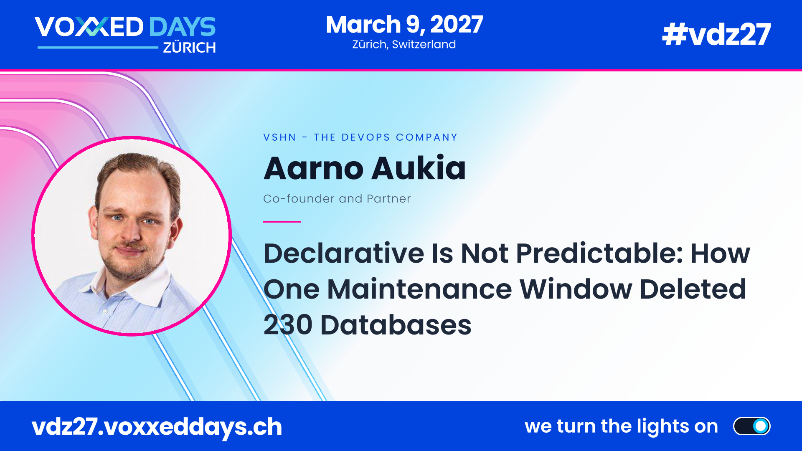
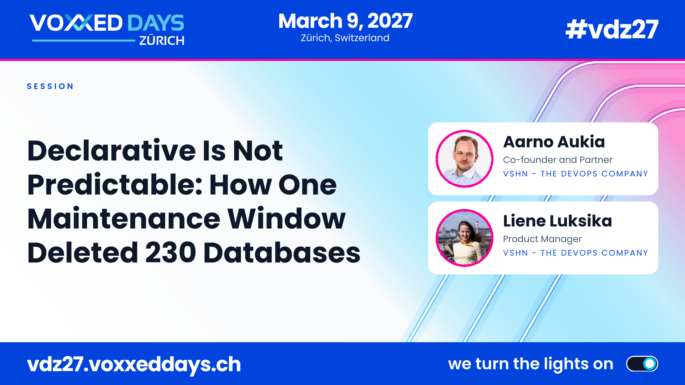

# Speaker Cards Generator

[](https://github.com/patbaumgartner/speaker-cards-generator/actions/workflows/ci.yml)
[](LICENSE)
[](https://adoptium.net/)
[](https://spring.io/projects/spring-boot)

> Generate professional **speaker and talk banner images** (PNG) for **Voxxed Days Zürich**,
> **Voxxed Days Ticino**, and **Voxxed Days CERN**.

---

## 🖼️ Preview

**Speaker card** (1920 × 1080 px)



**Talk card** (1920 × 1080 px)



---

## ✨ Features

- 🎨 **Banner generation** – speaker card (16:9), talk card (16:9), and social card (1:1 square)
- 📥 **Speaker import** – from the [Devoxx CFP API](https://cfp.dev)
- 🎛️ **Multi-event profiles** – switch between events by activating a Spring profile
- 🌐 **Web UI** – Bootstrap-based speaker directory with one-click download
- 🐳 **Docker-ready** – `Dockerfile` + `compose.yml` included
- 🔄 **Auto-start database** – Spring Boot Docker Compose starts PostgreSQL automatically during local development

---

## 🚀 Quick Start

### With Docker Compose – full-stack (recommended for production-like setup)

```shell
# Start PostgreSQL + the application in Docker
docker compose --profile deploy up -d
```

Open <http://localhost:8080> in your browser.

### Local development (database auto-starts)

Prerequisites: Java 21+, Maven 3.9+, Docker

Spring Boot automatically starts PostgreSQL via Docker Compose (`compose.yml`) when you run:

```shell
./mvnw spring-boot:run -Dspring-boot.run.profiles=vdz
```

No manual `docker compose up` step is needed — the database container is started and stopped
together with the application.

---

## 🎯 Conference Profiles

| Profile | Event |
|---------|-------|
| `vdz` | Voxxed Days Zürich |
| `vdt` | Voxxed Days Ticino |
| `vdcern` | Voxxed Days CERN |

All three profiles use a neon **"lights on"** stage-lighting overlay behind the speaker
and session content.

```shell
# Activate a profile
./mvnw spring-boot:run -Dspring-boot.run.profiles=vdt
```

Adding support for a new event takes less than a minute –
create a new `application-{profile}.properties` file with the event-specific branding.

---

## 📥 Import Speakers

```shell
# From the Devoxx CFP API using the configured event
curl -X POST http://localhost:8080/api/import/devoxx

# Or for a specific event ID
curl -X POST http://localhost:8080/api/import/devoxx/vdz27
```

---

## 🖼️ Generate Banners

```shell
# Generate all banners and save to ./speaker-banners/
curl -X POST "http://localhost:8080/api/banners/generate-all?outputDir=./speaker-banners"
```

---

## 🏗️ Project Structure

```
speaker-cards-generator/
├── .github/
│   ├── workflows/       – CI, CodeQL, Release pipelines
│   ├── ISSUE_TEMPLATE/  – Bug report & feature request forms
│   └── pull_request_template.md
├── src/                 – Spring Boot application source
│   ├── main/java/com/fortytwotalents/speakercardsgenerator/
│   │   ├── config/      – Spring configuration classes
│   │   ├── controller/  – Spring MVC controllers
│   │   ├── model/       – JPA entity classes
│   │   ├── repository/  – Spring Data JPA repositories
│   │   ├── service/     – Business-logic services
│   │   └── util/        – Utility helpers
│   └── main/resources/
│       ├── templates/   – Thymeleaf HTML templates
│       ├── static/      – Static assets (CSS, fonts, images)
│       └── application*.properties – App and profile-specific config
├── compose.yml          – Docker Compose (db auto-start for dev; full-stack with --profile deploy)
├── Dockerfile           – Multi-stage Docker build
├── pom.xml
├── CHANGELOG.md
├── CONTRIBUTING.md
├── CODE_OF_CONDUCT.md
└── SECURITY.md
```

---

## 🤝 Contributing

Contributions are welcome! Please read [CONTRIBUTING.md](CONTRIBUTING.md) before
opening a pull request.

---

## 📜 License

This project is licensed under the [Apache License 2.0](LICENSE).
