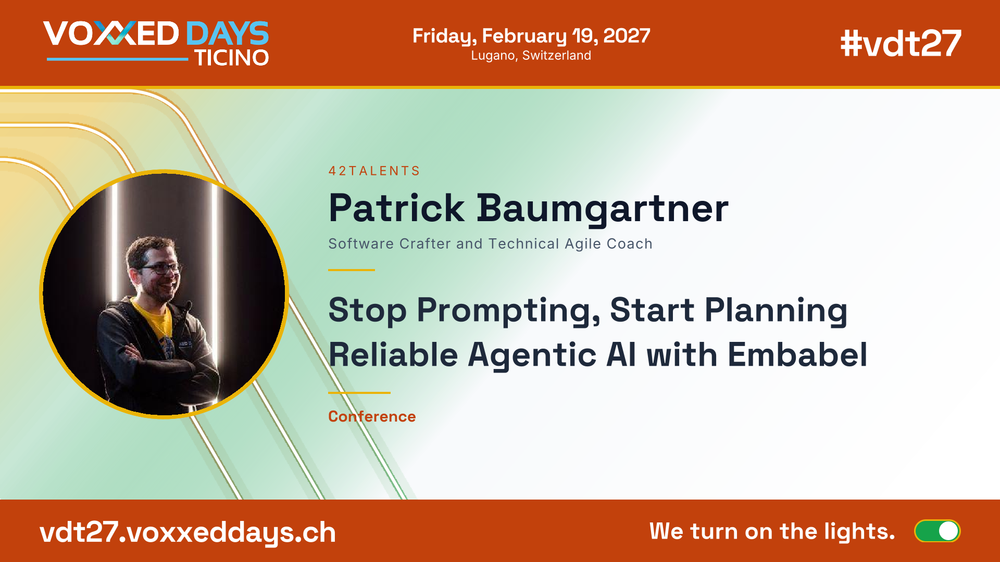
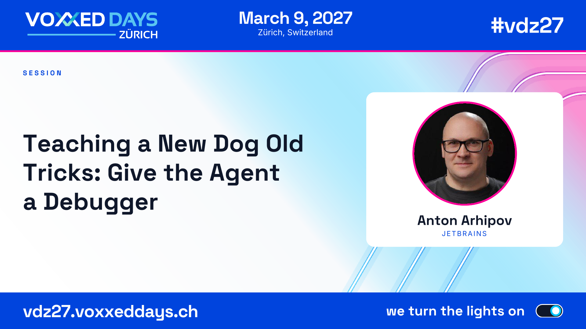

# Speaker Cards Generator

[](https://github.com/patbaumgartner/speaker-cards-generator/actions/workflows/ci.yml)
[](LICENSE)
[](https://adoptium.net/)
[](https://spring.io/projects/spring-boot)

> Generate professional **speaker and talk banner images** (PNG) for **Voxxed Days Zürich**,
> **Voxxed Days Ticino**, and **Voxxed Days CERN**.

---

## 🖼️ Preview

**Speaker banner** (1920 × 1080 px)



**Talk banner** (1920 × 1080 px)



**Social banner** (1620 × 1620 px)


---

## ✨ Features

- 🎨 **Banner generation** – speaker banner (16:9), talk banner (16:9), and social banner (1:1 square)
- 📥 **Speaker import** – from the [Devoxx CFP API](https://cfp.dev)
- 🎛️ **Multi-event profiles** – switch between events by activating a Spring profile
- 🌐 **Web UI** – Bootstrap-based speaker directory with one-click download
- 🐳 **Docker-ready** – `Dockerfile` + `compose.yml` included
- 🔄 **Auto-start database** – Spring Boot Docker Compose starts PostgreSQL automatically during local development

---

## 🚀 Quick Start

### With Docker Compose – full-stack (recommended for production-like setup)

```shell
# Start PostgreSQL + the application in Docker
docker compose --profile deploy up -d
```

Open <http://localhost:8080> in your browser.

### Local development (database auto-starts)

Prerequisites: Java 21+, Maven 3.9+, Docker

Spring Boot automatically starts PostgreSQL via Docker Compose (`compose.dev.yml`) when you run:

```shell
./mvnw spring-boot:run -Dspring-boot.run.profiles=vdz
```

Spring Boot connects to a private development database on a dynamically assigned loopback
port. PostgreSQL stores its data in memory. Stopping the application removes its managed
container, and the next run starts with an empty database. Local speaker photo files
persist. The full-stack deployment uses its own persistent PostgreSQL volume.

The development file requires Docker Compose 2.24.4 or later (`!override` support).

---

## 🎯 Conference Profiles

| Profile | Event |
|---------|-------|
| `vdz` | Voxxed Days Zürich |
| `vdt` | Voxxed Days Ticino |
| `vdcern` | Voxxed Days CERN |

If no profile is set, Spring activates the `vdz` profile by default.

All three profiles use a neon **"lights on"** stage-lighting overlay behind the speaker
and session content.

```shell
# Activate a profile
./mvnw spring-boot:run -Dspring-boot.run.profiles=vdt
```

Adding support for a new event takes less than a minute –
create a new `application-{profile}.properties` file with the event-specific branding.

---

## 📥 Import Speakers

```shell
# From the Devoxx CFP API using the configured event
curl -X POST http://localhost:8080/api/import/devoxx

# Or for a specific event ID
curl -X POST http://localhost:8080/api/import/devoxx/vdz27
```

Each import refreshes speaker profiles, talks, and portrait files from the CFP. If
the CFP provides several portrait URLs, the importer compares their pixel dimensions
and stores the highest-resolution download without recompression. The download limit
is configurable with `app.storage.max-photo-size` (default `5MB`).

The CFP session type (for example **Conference** or **Byte-Size**) appears
beneath the talk-title divider on banners. Workshop variants are recognized from
the type's name or slug and displayed as **Workshop**. Reimport existing talks
to refresh their session types and workshop classification.

The public import works without a token. Adding a token also checks authenticated
speaker details for job titles and portrait URLs. If a response omits the job title,
an existing title is preserved; an explicitly blank title clears it.

To find it, sign in to your CFP instance, open the browser developer tools (`F12`) and select
the **Network** tab. Reload the page, choose an authenticated request such as `/api/account`,
and copy the `Authorization: Bearer …` header value. The application strips the `Bearer`
prefix for you. Endpoint patterns are:

```text
https://{eventId}.cfp.dev/api/public/speakers
https://{eventId}.cfp.dev/api/account
```

For example:

```shell
curl --url 'https://vdz27.cfp.dev/api/account' \
  -H 'Accept: application/json' \
  -H 'Authorization: Bearer <PASTE_YOUR_TOKEN_HERE>'
```

Treat the token as a credential: never commit it, paste it into issues, or share screenshots
while it is visible.

---

## 🖼️ Generate Banners

Event profiles set `app.event.date` with the weekday (for example,
`Tuesday, March 9, 2027`). An optional `app.event.workshop-date` adds a separate
workshop-day line in the header; Ticino uses `Thursday, February 18, 2027`.
For workshop sessions, this becomes the main header date instead of the conference
date, without repeating the workshop-day line. Events without a separate workshop
date keep their configured event date.

Each session in the speaker directory has its own speaker, session and social
banner preview and PNG download. Workshop variants use the workshop date.
Bulk downloads and disk exports include every session variant, not just the first
session of each speaker. Speakers without sessions still get general speaker and
social banners.

All PNG downloads, ZIP entries and exported files share the same lowercase,
path-safe naming scheme:

- Session: `{event}-{category}-{sessionId}-{sessionTitle}-session.png`
- Speaker/social: `{event}-{category}-{sessionId}-{sessionTitle}-{speakerName}-{speakerUuid}-{speaker|social}.png`
- Without a session: `{event}-{speakerName}-{speakerUuid}-{speaker|social}.png`

For example: `vdt27-workshop-4243-hands-on-java-session.png`. Stable IDs prevent
collisions for identical titles or speaker names; long text components are
shortened. ZIPs and disk exports use `speaker/`, `sessions/` and `social/`
directories (replacing the old `talks/` directory and `-talk` naming).
The existing `/talk-banner/` and `/api/banners/download/talks` URLs remain valid.
Speaker/social preview and PNG URLs accept `?talkId={sessionId}`; without it,
they retain a default session. PDFs are intermediate rendering files, not downloads.

```shell
# Generate all banners and save to ./speaker-banners/
curl -X POST "http://localhost:8080/api/banners/generate-all?outputDir=./speaker-banners"
```

---

## 🏗️ Project Structure

```
speaker-cards-generator/
├── .github/
│   ├── workflows/       – CI, CodeQL, Release pipelines
│   ├── ISSUE_TEMPLATE/  – Bug report & feature request forms
│   └── pull_request_template.md
├── src/                 – Spring Boot application source
│   ├── main/java/com/fortytwotalents/speakercardsgenerator/
│   │   ├── config/      – Spring configuration classes
│   │   ├── controller/  – Spring MVC controllers
│   │   ├── model/       – JPA entity classes
│   │   ├── repository/  – Spring Data JPA repositories
│   │   ├── service/     – Business-logic services
│   │   └── util/        – Utility helpers
│   └── main/resources/
│       ├── templates/   – Thymeleaf HTML templates
│       ├── static/      – Static assets (CSS, fonts, images)
│       └── application*.properties – App and profile-specific config
├── compose.yml          – Docker Compose (db auto-start for dev; full-stack with --profile deploy)
├── Dockerfile           – Multi-stage Docker build
├── pom.xml
├── CHANGELOG.md
├── CONTRIBUTING.md
├── CODE_OF_CONDUCT.md
└── SECURITY.md
```

---

## 🤝 Contributing

Contributions are welcome! Please read [CONTRIBUTING.md](CONTRIBUTING.md) before
opening a pull request.

---

## 📜 License

This project is licensed under the [Apache License 2.0](LICENSE).
